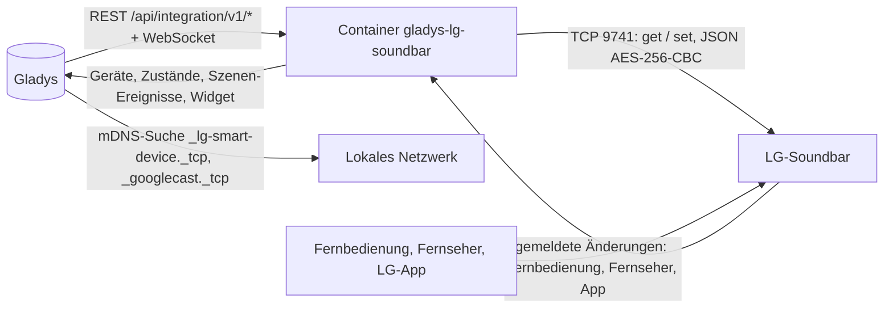
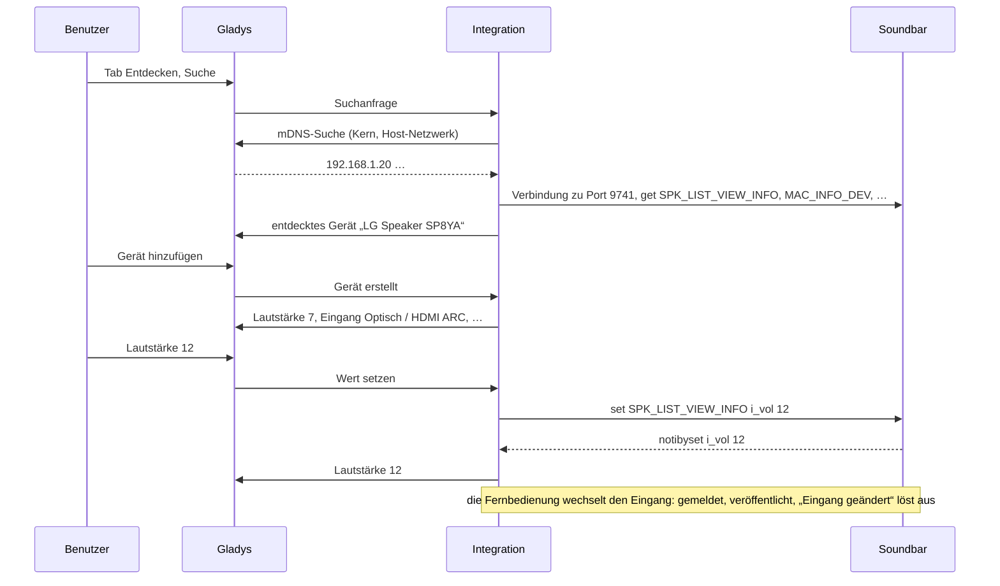
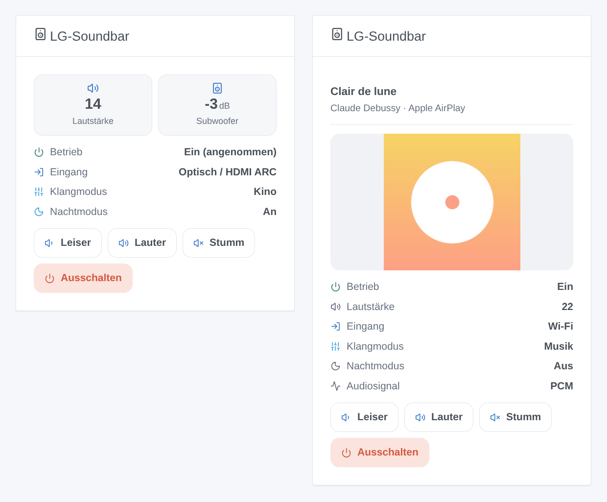

# Gladys LG Soundbar

[English](README.md) · [Français](README.fr.md) · **Deutsch** · [Español](README.es.md)

[](LICENSE)
[](https://github.com/William-De71/gladys-lg-soundbar/releases)
[](https://github.com/William-De71/gladys-lg-soundbar/actions/workflows/release.yml)
[](https://gladysassistant.com)


Externe Integration für [Gladys Assistant](https://gladysassistant.com) für die **LG-WLAN-Soundbars**, die mit der App LG Sound Bar (oder Wi-Fi Speaker) gesteuert werden: Ein/Aus, Lautstärke, Stummschaltung, Eingang, Klangmodus, Nachtmodus, Lautsprecherpegel und laufender Titel, nur in deinem lokalen Netzwerk. Änderungen mit der Fernbedienung oder dem Fernseher erscheinen sofort in Gladys, und deine Szenen können darauf reagieren oder eine Klangvoreinstellung anwenden.

Benutzerdokumentation: [English](docs/en.md) · [Français](docs/fr.md) · [Deutsch](docs/de.md) · [Español](docs/es.md).

Nicht mit LG Electronics verbunden. **Noch nicht mit einer echten Soundbar getestet**: Das Protokoll wurde nach [python-temescal](https://github.com/google/python-temescal) (der Bibliothek der Home-Assistant-Integration) neu geschrieben, und die Test-Soundbar, gegen die es geprüft wird, wurde selbst mit dieser Bibliothek geprüft.

## Funktionen

- **Soundbars werden selbst gefunden** (mDNS über Gladys: LG- und Chromecast-Ankündigungen) oder über ihre IP-Adresse.
- **Ein Gerät pro Soundbar**, mit dem, was das Modell meldet: Ein/Aus, Lautstärke (auf das Maximum der Soundbar begrenzt), Stummschaltung, Eingang und Klangmodus (Listen von der Soundbar gelesen), Nachtmodus, automatische Lautstärke, Dynamikkompression, automatisches Einschalten, Pegel von Subwoofer / Rücklautsprechern / Center / Höhenlautsprechern in dB, Wiedergabe / Pause, Titel und Interpret beim Streamen, Audiosignal.
- **Gemeldet, nicht abgefragt**: eine gehaltene Verbindung pro Soundbar; eine Änderung mit der Fernbedienung, dem Fernseher (HDMI CEC) oder der LG-App ist in weniger als einer Sekunde in Gladys. Eine Soundbar im Standby wird nie abgefragt, denn eine Anfrage würde sie einschalten.
- **5 Szenen-Auslöser** (Eingang geändert, Klangmodus geändert, neuer Titel, Soundbar nicht erreichbar, wieder erreichbar), **2 Szenen-Aktionen** (Klangvoreinstellung anwenden, Lautstärke um Stufen ändern) und **1 Dashboard-Widget** (Zustand, Cover des Titels, kleine Fernbedienung).
- Nur lokal: kein Konto, keine Cloud, nichts verlässt dein Netzwerk.
- Überall vier Sprachen: Englisch, Französisch, Deutsch, Spanisch.

## Funktionsweise




Von der Suche bis zum Befehl:



### Transport

`transports: ["local"]`: Die Integration spricht mit den Soundbars nur in deinem lokalen Netzwerk, über ihren TCP-Port 9741 (das „temescal“-Protokoll der LG-App: JSON, mit AES-256-CBC und dem festen Schlüssel aller Clients verschlüsselt). Die Suche läuft über Gladys (mDNS). Die einzige andere Anfrage ist das Cover eines Titels, von der Soundbar selbst gelesen (ihr Port 7000), wenn sie eines liefert. **Nichts verlässt dein Netzwerk.** `/data` speichert die gesehenen Soundbars (Adresse, Modell, letzter Zustand), damit ein Neustart sie nichts fragen muss.

## Geräte und Funktionen

| Funktion                                                            | Gladys-Typ              | Hinweise                                                                                                                                                                                                 |
| ------------------------------------------------------------------- | ----------------------- | -------------------------------------------------------------------------------------------------------------------------------------------------------------------------------------------------------- |
| Ein/Aus                                                             | television / binary     | `b_powerkey`; von neuen Modellen gemeldet (`b_powerstatus`), sonst **angenommen** (letzter Befehl, an bei Benutzung, aus wenn nicht erreichbar). Manche Modelle ignorieren „Aus“ über das Netzwerk.      |
| Lautstärke                                                          | television / volume     | von 0 bis zum Maximum der Soundbar (oft 40)                                                                                                                                                              |
| Stummschaltung                                                      | switch / binary         | 1 = stumm                                                                                                                                                                                                |
| Eingang                                                             | text / select           | von der Soundbar aufgelistete Eingänge (Wi-Fi, Bluetooth, Optisch / HDMI ARC, HDMI…); ein nicht aufgelisteter aktueller Eingang erscheint als sein aufgelistetes Gegenstück (E-ARC → Optisch / HDMI ARC) |
| Klangmodus                                                          | text / select           | von der Soundbar aufgelistete Klangmodi (AI Sound Pro, Standard, Kino, Musik…)                                                                                                                           |
| Nachtmodus, automatische Lautstärke, DRC, automatisches Einschalten | switch / binary         | wenn das Modell sie meldet                                                                                                                                                                               |
| Pegel von Subwoofer, hinten, Center, Höhe                           | television / volume, dB | der Bereich der Soundbar (−15 bis +6 dB für den Subwoofer einer SP8YA)                                                                                                                                   |
| Wiedergabe                                                          | music / playback_state  | 1 läuft, 0 Pause; nur für an die Soundbar gestreamte Musik                                                                                                                                               |
| Titel, Interpret                                                    | text                    | beim Streamen (Chromecast, AirPlay, Spotify Connect…)                                                                                                                                                    |
| Audiosignal                                                         | text                    | neue Modelle: „DOLBY AUDIO“, „PCM“, „NO SIGNAL“                                                                                                                                                          |

## Szenen-Auslöser, Aktionen und Widgets



Die Bilder sind **generierte Illustrationen**, mit dem echten Code des Widgets aus erfundenen Daten gezeichnet, keine Screenshots.

**Widget „LG-Soundbar“** (eine Soundbar, standardmäßig die erste): Kacheln für Lautstärke und Subwoofer, Betrieb, Eingang, Klangmodus, Nachtmodus und Audiosignal, beim Streamen Titel und Cover, und vier Tasten: leiser, lauter, stumm / Ton an, ein- / ausschalten.

**Szenen-Auslöser** — nur für Änderungen außerhalb von Gladys (Fernbedienung, Fernseher, LG-App), nie für eine Änderung, die Gladys gerade gesendet hat:

| Auslöser                         | Filter                   | Variablen                         |
| -------------------------------- | ------------------------ | --------------------------------- |
| LG-Soundbar: Eingang geändert    | Soundbar, neue Eingänge  | Eingang, vorheriger Eingang       |
| LG-Soundbar: Klangmodus geändert | Soundbar, neue Klangmodi | Klangmodus, vorheriger Klangmodus |
| LG-Soundbar: neuer Titel         | Soundbar                 | Titel, Interpret, gestreamt über  |
| LG-Soundbar: nicht erreichbar    | Soundbar                 | —                                 |
| LG-Soundbar: wieder erreichbar   | Soundbar                 | —                                 |

Ein/Aus, Lautstärke, Stummschaltung und die Schalter sind numerische Funktionen: Nutze für sie den üblichen Auslöser „Gerätezustand geändert“ von Gladys.

**Szenen-Aktionen**:

| Aktion                                    | Felder                                                                     | Ausgaben                        |
| ----------------------------------------- | -------------------------------------------------------------------------- | ------------------------------- |
| LG-Soundbar: Klangvoreinstellung anwenden | Soundbar, Eingang, Klangmodus, Nachtmodus, Lautstärke (leer = unverändert) | Lautstärke, Eingang, Klangmodus |
| LG-Soundbar: Lautstärke ändern            | Soundbar, Stufen (−20 bis +20)                                             | Lautstärke                      |

Beispiele:

- **Eingang geändert** auf Bluetooth → Fernseher ausschalten und das Wohnzimmer dimmen: Jemand spielt Musik vom Handy.
- **Um 22 Uhr** → die Voreinstellung „Optisch / HDMI ARC, Kino, Nachtmodus an, Lautstärke 12“ anwenden.
- **Wenn das Telefon klingelt** → Lautstärke um −8 ändern; nach dem Anruf +8.

## Voraussetzungen

- Gladys Assistant **5.1.0** oder neuer (Dashboard-Widgets und Szenen-Auslöser / -Aktionen): Ältere Instanzen können die Integration nicht installieren.
- Eine LG-WLAN-Soundbar, eingerichtet mit der App **LG Sound Bar** oder **Wi-Fi Speaker**, im selben Netzwerk wie Gladys (oder von dort über TCP 9741 erreichbar). Manche neuen Modelle, die nur über **LG ThinQ** gesteuert werden, öffnen Port 9741 nicht (python-temescal-Issue #14): Sie funktionieren nicht.
- Eine feste IP-Adresse für die Soundbar (DHCP-Reservierung) ist am besten; die Integration folgt einer Soundbar mit neuer Adresse, indem sie erneut sucht.

### Standby und einzelne Verbindung

Eine Soundbar im Standby schaltet sich ein, wenn sie abgefragt wird (python-temescal-Issue #7): Die Integration liest den Zustand beim Start und nachdem die Soundbar nicht erreichbar war, danach hört sie nur zu. Die Option **Soundbar nie aufwecken** entfernt diese Abfragen. Ob eine Soundbar mehrere Clients gleichzeitig annimmt (LG-App, Home Assistant und Gladys), ist nicht dokumentiert: Wenn Befehle nicht mehr ankommen, während ein anderes Werkzeug verbunden ist, schließe es.

## Installation

- **Aus dem Store**: Integrationen → LG Soundbar → Installieren.
- **Über die URL des Repositorys**: Integrationen → Über eine URL installieren → `https://github.com/William-De71/gladys-lg-soundbar`.
- **Entwicklermodus**: Starte den Container selbst mit den Variablen, die Gladys anzeigt (siehe Entwicklung).

## Konfiguration

| Feld                   | Standard | Bedeutung                                                                                                         |
| ---------------------- | -------- | ----------------------------------------------------------------------------------------------------------------- |
| IP-Adressen            | leer     | Soundbars, die die Suche nicht findet (anderes Subnetz, Multicast blockiert), durch Kommas getrennt               |
| Im Netzwerk suchen     | an       | mDNS-Suche über Gladys bei jeder Suche im Tab Entdecken und wenn eine Soundbar nicht mehr antwortet               |
| Soundbar nie aufwecken | aus      | eine Soundbar nie von selbst abfragen: Der Zustand kommt nur aus ihren Änderungen und deinen Befehlen             |
| Sprache der Namen      | Englisch | Namen der Funktionen, Eingänge, Klangmodi und Texte der Szenen (Gladys teilt die Sprache des Benutzers nicht mit) |

**Soundbars suchen und testen** (Taste der Konfiguration) sucht und listet dann jede gefundene Soundbar mit Adresse, Modell und Verbindungsstatus auf.

## Verwendung

1. Richte die Soundbar in der App LG Sound Bar im Netzwerk von Gladys ein.
2. Installiere die Integration; drücke **Soundbars suchen und testen**.
3. **Entdecken**, dann deine Soundbar als Gerät hinzufügen.
4. Füge das Widget einem Dashboard hinzu; baue Szenen mit den Funktionen, Auslösern und Aktionen.

## Entwicklung

```bash
npm install
npm test                       # node --test, falsche Soundbars auf 127.0.0.1, nie das Netzwerk
npm run lint                   # ESLint
npm run format:check           # Prettier
npx github:GladysAssistant/integration-store . --skip-image-check
node scripts/fake-soundbar.mjs 9741 SP8YA   # eine falsche Soundbar zum Ausprobieren ohne echte
scripts/check-simulator.sh     # die falsche Soundbar gegen python-temescal 0.5 (virtualenv)
scripts/build-cover.sh         # cover.jpg aus docs/assets/cover.svg
docs/illustrations/render.sh   # docs/assets/widgets.<sprache>.png
```

Lokal liest das SDK `GLADYS_HOST_API_URL`, `GLADYS_INTEGRATION_TOKEN` und `GLADYS_INTEGRATION_SELECTOR` (von Gladys im Entwicklermodus angegeben); `LG_SOUNDBAR_DATA_DIR` verschiebt `/data`. `DEBUG=gladys-integration-sdk` zeigt die Logs des SDK.

Die Tests decken die Verschlüsselung (ein von python-temescal erzeugter Frame), die Rahmung (geteilt, zusammengefasst, reines JSON, Müll), den Client (eine Anfrage nach der anderen, Ablehnungen, Zeitüberschreitungen, stilles Neuverbinden, wachsende Wartezeit, neue Adresse), den aus Nachrichten echter Modelle (SP8YA, S90QY) gebauten Zustand, die Befehle und ihre Grenzen, die Geräte (die vom Tab Entdecken verlangten Felder, die Paare Kategorie / Typ), die Szenen-Ereignisse, das Widget (`validateWidgetContent`), das Manifest, die vier Sprachen, das Release-Skript und die ganze Integration gegen das falsche Gladys des SDK und falsche Soundbars auf echten Sockets ab. `test/structure.test.js` friert jeden Schlüssel ein, den Benutzer speichern.

## Release-Prozess


Jeder Merge auf `main` startet die CI und berechnet dann die Version aus den [Conventional Commits](https://www.conventionalcommits.org/) seit dem letzten Tag: `feat` → Minor, `fix` / `perf` → Patch, `!` oder `BREAKING CHANGE` → Major (ein Minor unter 1.0.0); `docs`, `chore`, `ci`, `test`, `style`, `refactor`, `build` allein veröffentlichen nichts. Der Changelog-Abschnitt wird erzeugt, der Tag gepusht, das Multi-Architektur-Image gebaut, dann erhält `main` den Release-Commit, das GitHub Release wird erstellt und ein letzter Job prüft das öffentliche Image, den Store-Validator und das Topic.

- Der Titel des Pull Requests wird zum Squash-Commit und dann zur Changelog-Zeile: Schreibe ihn auf Englisch, für den Benutzer (`pr-title.yml` prüft ihn). Bearbeite `CHANGELOG.md` nie von Hand.
- 1.0.0 ist eine Entscheidung: Actions → Release → Run workflow mit `release-as: 1.0.0`. `dry-run` zeigt Version und Notizen, ohne zu veröffentlichen.
- **Geschützter Branch**: Das Release pusht seinen Commit mit `GITHUB_TOKEN` auf `main`. Das Ruleset `protect-main` (kein Löschen, kein Force-Push) lässt ihn durch; eine strengere Regel (Pull Request Pflicht, Status Checks) bräuchte GitHub Actions in der Bypass-Liste oder eine GitHub App.
- Mache nach dem ersten Release das Paket `ghcr.io` öffentlich (Package settings → Change visibility), sonst kann Gladys es nicht laden.

## Fehlerbehebung

Siehe [docs/de.md](docs/de.md#fehlerbehebung). Melde Probleme mit den Versionen von Gladys und der Integration, Modell und Firmware der Soundbar, der Meldung von **Soundbars suchen und testen** und den Logs mit `DEBUG=gladys-integration-sdk`.

## Mitwirken

Issues und Pull Requests sind willkommen. Führe `npm run format:check && npm run lint && npm test` vor einem Pull Request aus und lass jede externe ID und jeden gespeicherten Schlüssel unverändert (siehe [CLAUDE.md](CLAUDE.md)). Ein Mitschnitt dessen, was dein Modell antwortet (`scripts/fake-soundbar.mjs` zeigt das Format), hilft am meisten.

## Sicherheit

Siehe [SECURITY.md](SECURITY.md): Melde Schwachstellen vertraulich. Die Integration hat kein Geheimnis zu hüten; sie öffnet nur Verbindungen zu den in deinem Netzwerk gefundenen oder in der Konfiguration eingegebenen Adressen und liest ein Cover nur von der Adresse der Soundbar.

## Kommende Screenshots

Die Bilder oben sind Illustrationen, keine Screenshots. Echte Screenshots kommen nach `docs/assets/screenshots/` (PNG, 1280 × 800): `configuration.png`, `discovery.png`, `device.png` (eine Soundbar mit ihren Funktionen auf einem Dashboard), `scene-trigger.png` (der Auslöser „Eingang geändert“), `scene-preset.png` (die Aktion „Klangvoreinstellung anwenden“).

## Lizenz

[Apache License 2.0](LICENSE) — siehe auch [NOTICE](NOTICE). LG ist eine Marke von LG Electronics. Danke an die Dokumentation und das SDK von Gladys, an python-temescal (Google LLC, Apache 2.0) für das Protokoll und an die Home-Assistant-Integration und lgsb2mqtt für das, was echte Soundbars melden.
