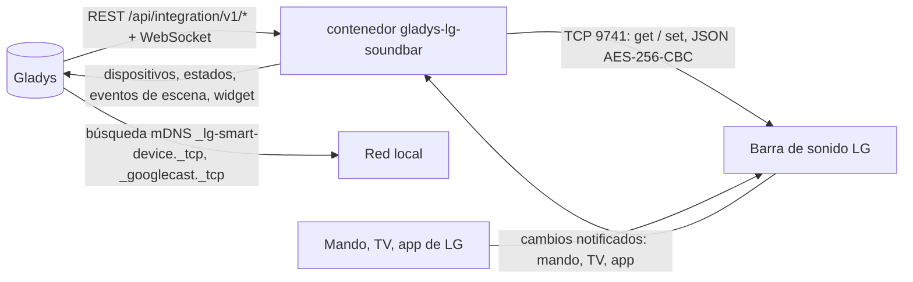
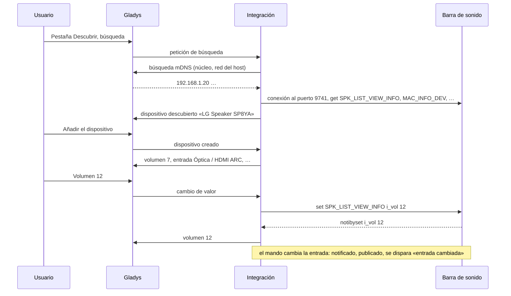
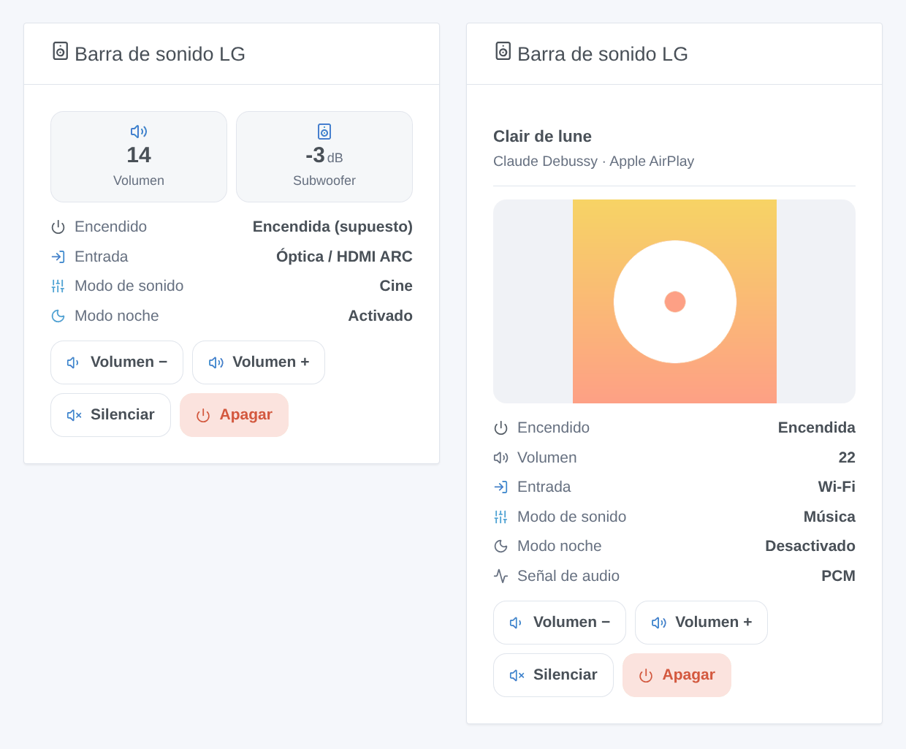

# Gladys LG Soundbar

[English](README.md) · [Français](README.fr.md) · [Deutsch](README.de.md) · **Español**

[](LICENSE)
[](https://github.com/William-De71/gladys-lg-soundbar/releases)
[](https://github.com/William-De71/gladys-lg-soundbar/actions/workflows/release.yml)
[](https://gladysassistant.com)


Integración externa de [Gladys Assistant](https://gladysassistant.com) para las **barras de sonido LG Wi-Fi** controladas con la app LG Sound Bar (o Wi-Fi Speaker): encendido, volumen, silencio, entrada, modo de sonido, modo noche, niveles de los altavoces y canción en curso, solo en su red local. Los cambios hechos con el mando o la TV aparecen al instante en Gladys, y sus escenas pueden reaccionar o aplicar un ajuste de sonido.

Documentación de usuario: [English](docs/en.md) · [Français](docs/fr.md) · [Deutsch](docs/de.md) · [Español](docs/es.md).

Sin afiliación con LG Electronics. **Aún no probada con una barra de sonido real**: el protocolo se reescribió a partir de [python-temescal](https://github.com/google/python-temescal) (la biblioteca de la integración de Home Assistant), y la barra de sonido de prueba con la que se comprueba se verificó a su vez con esa biblioteca.

## Funciones

- **Barras de sonido encontradas solas** (mDNS a través de Gladys: anuncios de LG y Chromecast), o por su dirección IP.
- **Un dispositivo por barra de sonido**, con lo que indica el modelo: encendido, volumen (limitado al máximo de la barra de sonido), silencio, entrada y modo de sonido (listas leídas en la barra de sonido), modo noche, volumen automático, compresión dinámica, encendido automático, niveles del subwoofer / altavoces traseros / canal central / altavoces verticales en dB, reproducir / pausar, canción y artista en streaming, señal de audio.
- **Caja Música de Gladys 5.3**: mientras se transmite música a la barra de sonido (Chromecast, AirPlay, Spotify Connect…), la caja **Música** del panel muestra la canción, el artista y la carátula, con reproducir / pausar, el volumen y el silencio. Lo que temescal no proporciona (álbum, duración, posición, siguiente / anterior, aleatorio, repetición) no se muestra.
- **Notificado, no consultado**: una conexión mantenida por barra de sonido; un cambio hecho con el mando, la TV (HDMI CEC) o la app de LG llega a Gladys en menos de un segundo. Nunca se pregunta nada a una barra de sonido en espera, que una petición encendería.
- **5 disparadores de escena** (entrada cambiada, modo de sonido cambiado, nueva canción, barra de sonido inaccesible, de nuevo accesible), **2 acciones de escena** (aplicar un ajuste de sonido, cambiar el volumen por pasos) y **1 widget del panel** (estado, portada de la canción, un pequeño mando).
- Solo local: sin cuenta, sin nube, nada sale de su red.
- Cuatro idiomas en todas partes: inglés, francés, alemán, español.

## Funcionamiento




De la búsqueda a una orden:



### Transporte

`transports: ["local"]`: la integración habla con las barras de sonido solo en su red local, por su puerto TCP 9741 (el protocolo «temescal» de la app de LG: JSON cifrado con AES-256-CBC y la clave fija que usan todos los clientes). La búsqueda pasa por Gladys (mDNS). La única otra petición es la portada de una canción, leída en la propia barra de sonido (su puerto 7000) cuando la ofrece. **Nada sale de su red.** `/data` guarda las barras de sonido vistas (dirección, modelo, último estado), para que un reinicio no tenga que preguntarles nada.

## Dispositivos y funciones

| Función                                                        | Tipo Gladys                                  | Notas                                                                                                                                                                                                  |
| -------------------------------------------------------------- | -------------------------------------------- | ------------------------------------------------------------------------------------------------------------------------------------------------------------------------------------------------------ |
| Encendido                                                      | television / binary                          | `b_powerkey`; indicado por los modelos recientes (`b_powerstatus`), **supuesto** si no (última orden, encendida cuando se usa, apagada si inaccesible). Algunos modelos ignoran el apagado por la red. |
| Volumen                                                        | television / volume                          | de 0 al máximo que indica la barra de sonido (a menudo 40)                                                                                                                                             |
| Silencio                                                       | switch / binary                              | 1 = sin sonido                                                                                                                                                                                         |
| Entrada                                                        | text / select                                | entradas listadas por la barra de sonido (Wi-Fi, Bluetooth, Óptica / HDMI ARC, HDMI…); una entrada actual fuera de la lista aparece como su equivalente listado (E-ARC → Óptica / HDMI ARC)            |
| Modo de sonido                                                 | text / select                                | modos listados por la barra de sonido (AI Sound Pro, Estándar, Cine, Música…)                                                                                                                          |
| Modo noche, volumen automático, DRC, encendido automático      | switch / binary                              | cuando el modelo los indica                                                                                                                                                                            |
| Niveles del subwoofer, traseros, central, verticales           | television / volume, dB                      | el rango de la barra de sonido (−15 a +6 dB para el subwoofer de una SP8YA)                                                                                                                            |
| Reproducción                                                   | music / playback_state                       | 1 reproduciendo, 0 en pausa; solo para la música transmitida a la barra de sonido                                                                                                                      |
| Canción, artista                                               | text                                         | en streaming (Chromecast, AirPlay, Spotify Connect…)                                                                                                                                                   |
| Reproductor: canción, artista, carátula, volumen (%), silencio | music / title, artist, artwork, volume, mute | para la caja **Música** de Gladys 5.3, junto con la reproducción; textos vacíos cuando no se transmite nada; la carátula solo desde la propia barra de sonido; el volumen en porcentaje de su rango    |
| Señal de audio                                                 | text                                         | modelos recientes: «DOLBY AUDIO», «PCM», «NO SIGNAL»                                                                                                                                                   |

## Disparadores, acciones de escena y widgets



Las imágenes son **ilustraciones generadas**, dibujadas por el código real del widget con datos inventados, no capturas de pantalla.

**Widget «Barra de sonido LG»** (una barra de sonido, la primera por defecto): mosaicos de volumen y subwoofer, encendido, entrada, modo de sonido, modo noche y señal de audio, la canción y su portada en streaming, y cuatro botones: volumen −, volumen +, silenciar / activar sonido, encender / apagar.

**Disparadores de escena** — solo para cambios hechos fuera de Gladys (mando, TV, app de LG), nunca para un cambio que Gladys acaba de enviar:

| Disparador                                  | Filtros                                 | Variables                               |
| ------------------------------------------- | --------------------------------------- | --------------------------------------- |
| Barra de sonido LG: entrada cambiada        | barra de sonido, nuevas entradas        | entrada, entrada anterior               |
| Barra de sonido LG: modo de sonido cambiado | barra de sonido, nuevos modos de sonido | modo de sonido, modo de sonido anterior |
| Barra de sonido LG: nueva canción           | barra de sonido                         | título, artista, transmitido por        |
| Barra de sonido LG: inaccesible             | barra de sonido                         | —                                       |
| Barra de sonido LG: de nuevo accesible      | barra de sonido                         | —                                       |

Encendido, volumen, silencio y los interruptores son funciones numéricas: use para ellos el disparador habitual «cambio de estado de un dispositivo» de Gladys.

**Acciones de escena**:

| Acción                                          | Campos                                                                              | Salidas                          |
| ----------------------------------------------- | ----------------------------------------------------------------------------------- | -------------------------------- |
| Barra de sonido LG: aplicar un ajuste de sonido | barra de sonido, entrada, modo de sonido, modo noche, volumen (vacío = sin cambios) | volumen, entrada, modo de sonido |
| Barra de sonido LG: cambiar el volumen          | barra de sonido, pasos (−20 a +20)                                                  | volumen                          |

Ejemplos:

- **Entrada cambiada** a Bluetooth → apagar la TV y atenuar el salón: alguien pone música desde un teléfono.
- **A las 22 h** → aplicar el ajuste «Óptica / HDMI ARC, Cine, modo noche activado, volumen 12».
- **Cuando suena el teléfono** → cambiar el volumen −8; al terminar la llamada, +8.

## Requisitos

- Gladys Assistant **5.3.0** o posterior (la caja Música; widgets del panel y disparadores / acciones de escena desde la 5.1.0): las instancias más antiguas no pueden instalar la integración.
- Una barra de sonido LG Wi-Fi configurada con la app **LG Sound Bar** o **Wi-Fi Speaker**, en la misma red que Gladys (o accesible en TCP 9741 desde él). Algunos modelos recientes, controlados solo con **LG ThinQ**, no abren el puerto 9741 (incidencia #14 de python-temescal): no pueden funcionar.
- Lo mejor es una dirección IP fija para la barra de sonido (reserva DHCP); la integración sigue a una barra de sonido que cambia de dirección buscándola de nuevo.

### Espera y conexión única

Una barra de sonido en espera se enciende cuando se le pregunta algo (incidencia #7 de python-temescal): la integración lee el estado al arrancar y después de que la barra de sonido estuviera inaccesible, y luego solo escucha. La opción **No despertar nunca la barra de sonido** elimina esas lecturas. No está documentado si una barra de sonido acepta varios clientes a la vez (la app de LG, Home Assistant y Gladys): si las órdenes dejan de funcionar mientras otra herramienta está conectada, ciérrela.

## Instalación

- **Desde la tienda**: Integraciones → LG Soundbar → Instalar.
- **Desde la URL del repositorio**: Integraciones → Instalar desde una URL → `https://github.com/William-De71/gladys-lg-soundbar`.
- **Modo desarrollador**: ejecute usted mismo el contenedor con las variables que muestra Gladys (ver Desarrollo).

## Configuración

| Campo                                 | Por defecto | Significado                                                                                                               |
| ------------------------------------- | ----------- | ------------------------------------------------------------------------------------------------------------------------- |
| Direcciones IP                        | vacío       | barras de sonido que la búsqueda no encuentra (otra subred, multicast bloqueado), separadas por comas                     |
| Buscar en la red                      | activado    | búsqueda mDNS a través de Gladys en cada búsqueda de la pestaña Descubrir, y cuando una barra de sonido deja de responder |
| No despertar nunca la barra de sonido | desactivado | no preguntar nunca nada por sí misma a una barra de sonido: el estado solo viene de sus cambios y de sus órdenes          |
| Idioma de los nombres                 | inglés      | nombres de las funciones, entradas, modos de sonido y textos de las escenas (Gladys no indica el idioma del usuario)      |

**Buscar y probar las barras de sonido** (botón de la configuración) busca y luego lista cada barra de sonido encontrada con su dirección, su modelo y si está conectada.

## Uso

1. Configure la barra de sonido en la app LG Sound Bar, en la red de Gladys.
2. Instale la integración; pulse **Buscar y probar las barras de sonido**.
3. **Descubrir**, y añada su barra de sonido como dispositivo.
4. Añada el widget a un panel; cree escenas con las funciones, los disparadores y las acciones.

## Desarrollo

```bash
npm install
npm test                       # node --test, barras de sonido falsas en 127.0.0.1, nunca la red
npm run lint                   # ESLint
npm run format:check           # Prettier
npx github:GladysAssistant/integration-store . --skip-image-check
node scripts/fake-soundbar.mjs 9741 SP8YA   # una barra de sonido falsa para probar sin tener una
scripts/check-simulator.sh     # la barra de sonido falsa frente a python-temescal 0.5 (virtualenv)
scripts/build-cover.sh         # cover.jpg a partir de docs/assets/cover.svg
docs/illustrations/render.sh   # docs/assets/widgets.<idioma>.png
```

En local, el SDK lee `GLADYS_HOST_API_URL`, `GLADYS_INTEGRATION_TOKEN` y `GLADYS_INTEGRATION_SELECTOR` (que Gladys da en modo desarrollador); `LG_SOUNDBAR_DATA_DIR` mueve `/data`. `DEBUG=gladys-integration-sdk` muestra los registros del SDK.

Las pruebas cubren el cifrado (una trama producida por python-temescal), el entramado (cortado, agrupado, JSON en claro, basura), el cliente (una petición cada vez, rechazos, tiempos agotados, reconexión silenciosa, espera creciente, nueva dirección), el estado construido a partir de los mensajes de modelos reales (SP8YA, S90QY), las órdenes y sus límites, los dispositivos (los campos que exige la pestaña Descubrir, los pares categoría / tipo), los eventos de escena, el widget (`validateWidgetContent`), el manifiesto, los cuatro idiomas, el script de release, y toda la integración frente al Gladys falso del SDK y barras de sonido falsas en sockets reales. `test/structure.test.js` congela todas las claves que guardan los usuarios.

## Proceso de release


Cada fusión en `main` lanza la CI y luego calcula la versión a partir de los [Conventional Commits](https://www.conventionalcommits.org/) desde la última etiqueta: `feat` → menor, `fix` / `perf` → parche, `!` o `BREAKING CHANGE` → mayor (una menor por debajo de 1.0.0); `docs`, `chore`, `ci`, `test`, `style`, `refactor`, `build` solos no publican nada. Se genera la sección del changelog, se envía la etiqueta, se construye la imagen multiarquitectura, luego `main` recibe el commit de release, se crea la GitHub Release y un último job comprueba la imagen pública, el validador de la tienda y el topic.

- El título de la pull request se convierte en el commit squash y luego en la línea del changelog: escríbalo en inglés, para el usuario (`pr-title.yml` lo comprueba). No edite nunca `CHANGELOG.md` a mano.
- 1.0.0 es una decisión: Actions → Release → Run workflow con `release-as: 1.0.0`. `dry-run` muestra la versión y las notas sin publicar.
- **Rama protegida**: la release envía su commit a `main` con `GITHUB_TOKEN`. El ruleset `protect-main` (ni borrado, ni force-push) lo deja pasar; una regla más estricta (pull request obligatoria, status checks) necesitaría GitHub Actions en la lista de excepciones, o una GitHub App.
- Tras la primera release, haga público el paquete `ghcr.io` (Package settings → Change visibility), o Gladys no podrá descargarlo.

## Solución de problemas

Ver [docs/es.md](docs/es.md#solución-de-problemas). Informe de los problemas con las versiones de Gladys y de la integración, el modelo y el firmware de la barra de sonido, el mensaje de **Buscar y probar las barras de sonido** y los registros con `DEBUG=gladys-integration-sdk`.

## Contribuir

Las incidencias y pull requests son bienvenidas. Ejecute `npm run format:check && npm run lint && npm test` antes de abrir una pull request, y no cambie ningún identificador externo ni ninguna clave guardada (ver [CLAUDE.md](CLAUDE.md)). Una captura de lo que responde su modelo (`scripts/fake-soundbar.mjs` muestra el formato) es lo que más ayuda.

## Seguridad

Ver [SECURITY.md](SECURITY.md): informe de las vulnerabilidades en privado. La integración no tiene ningún secreto que guardar; solo abre conexiones con las direcciones encontradas en su red o escritas en la configuración, y solo lee una portada en la dirección de la barra de sonido.

## Capturas por venir

Las imágenes de arriba son ilustraciones, no capturas de pantalla. Las capturas reales irán en `docs/assets/screenshots/` (PNG, 1280 × 800): `configuration.png`, `discovery.png`, `device.png` (una barra de sonido con sus funciones en un panel), `scene-trigger.png` (el disparador «entrada cambiada»), `scene-preset.png` (la acción «aplicar un ajuste de sonido»).

## Licencia

[Licencia Apache 2.0](LICENSE) — ver también [NOTICE](NOTICE). LG es una marca de LG Electronics. Gracias a la documentación y al SDK de Gladys, a python-temescal (Google LLC, Apache 2.0) por el protocolo, y a la integración de Home Assistant y a lgsb2mqtt por lo que indican las barras de sonido reales.
