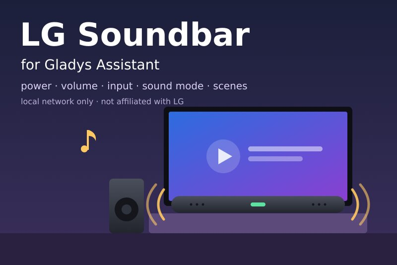
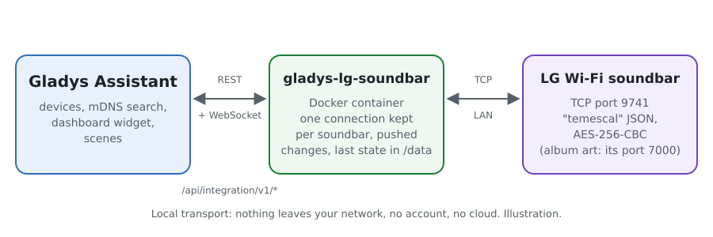
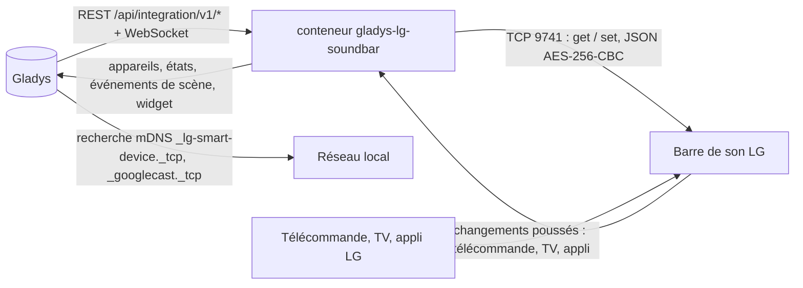
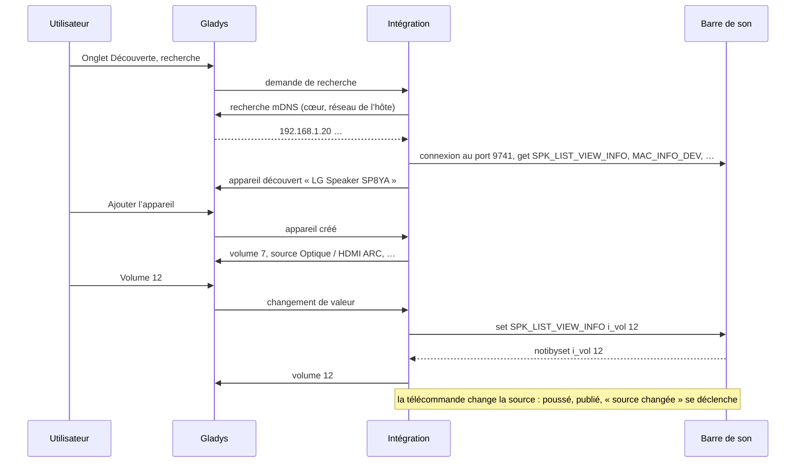
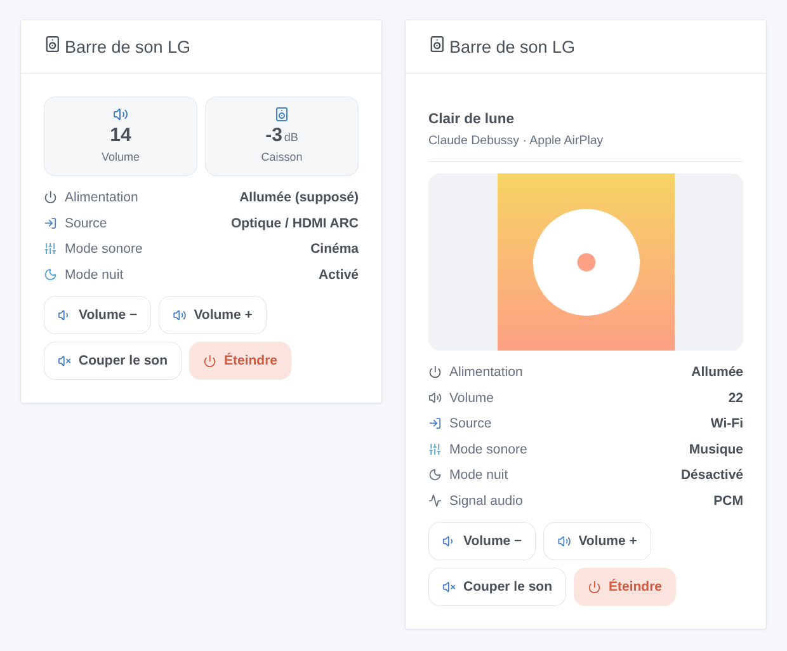

# Gladys LG Soundbar

[English](README.md) · **Français** · [Deutsch](README.de.md) · [Español](README.es.md)

[](LICENSE)
[](https://github.com/William-De71/gladys-lg-soundbar/releases)
[](https://github.com/William-De71/gladys-lg-soundbar/actions/workflows/release.yml)
[](https://gladysassistant.com)



Intégration externe [Gladys Assistant](https://gladysassistant.com) pour les **barres de son LG Wi-Fi** pilotées par l’appli LG Sound Bar (ou Wi-Fi Speaker) : marche/arrêt, volume, muet, source, mode sonore, mode nuit, niveaux des haut-parleurs et morceau en cours, sur votre réseau local uniquement. Les changements faits à la télécommande ou par la TV apparaissent aussitôt dans Gladys, et vos scènes peuvent y réagir ou appliquer un préréglage son.

Documentation utilisateur : [English](docs/en.md) · [Français](docs/fr.md) · [Deutsch](docs/de.md) · [Español](docs/es.md).

Non affiliée à LG Electronics. **Pas encore testée sur une vraie barre de son** : le protocole a été réécrit d’après [python-temescal](https://github.com/google/python-temescal) (la bibliothèque de l’intégration Home Assistant), et la barre de son de test qui sert de référence a elle-même été vérifiée avec cette bibliothèque.

## Fonctionnalités

- **Barres de son trouvées toutes seules** (mDNS via Gladys : annonces LG et Chromecast), ou par leur adresse IP.
- **Un appareil par barre de son**, avec ce que le modèle indique : marche/arrêt, volume (borné au maximum de la barre de son), muet, source et mode sonore (listes lues sur la barre de son), mode nuit, volume automatique, compression dynamique, allumage automatique, niveaux du caisson / des enceintes arrière / du canal central / des haut-parleurs verticaux en dB, lecture / pause, morceau et artiste en streaming, signal audio.
- **Boîte Musique de Gladys 5.3** : quand de la musique est envoyée à la barre de son (Chromecast, AirPlay, Spotify Connect…), la boîte **Musique** du tableau de bord affiche le morceau, l’artiste et la pochette, avec lecture / pause, le volume et la sourdine. Ce que temescal ne donne pas (album, durée, position, suivant / précédent, aléatoire, répétition) n’est pas affiché.
- **Poussé, pas interrogé** : une connexion gardée par barre de son ; un changement fait à la télécommande, par la TV (HDMI CEC) ou dans l’appli LG est dans Gladys en moins d’une seconde. Rien n’est demandé à une barre de son en veille, qu’une requête allumerait.
- **5 déclencheurs de scène** (source changée, mode sonore changé, nouveau morceau, barre de son injoignable, de nouveau joignable), **2 actions de scène** (appliquer un préréglage son, changer le volume de quelques crans) et **1 widget de tableau de bord** (état, pochette du morceau, petite télécommande).
- Local uniquement : ni compte, ni cloud, rien ne sort de votre réseau.
- Quatre langues partout : anglais, français, allemand, espagnol.

## Fonctionnement





De la recherche à une commande :



### Transport

`transports: ["local"]` : l’intégration parle aux barres de son uniquement sur votre réseau local, par leur port TCP 9741 (le protocole « temescal » de l’appli LG : du JSON chiffré en AES-256-CBC avec la clé fixe qu’utilisent tous les clients). La recherche passe par Gladys (mDNS). La seule autre requête est la pochette d’un morceau, lue sur la barre de son elle-même (son port 7000) quand elle en donne une. **Rien ne sort de votre réseau.** `/data` garde les barres de son vues (adresse, modèle, dernier état), pour qu’un redémarrage n’ait rien à leur demander.

## Appareils et fonctionnalités

| Fonctionnalité                                           | Type Gladys                                  | Remarques                                                                                                                                                                                                   |
| -------------------------------------------------------- | -------------------------------------------- | ----------------------------------------------------------------------------------------------------------------------------------------------------------------------------------------------------------- |
| Marche/arrêt                                             | television / binary                          | `b_powerkey` ; indiquée par les modèles récents (`b_powerstatus`), **supposée** sinon (dernier ordre, allumée quand elle sert, éteinte quand injoignable). Certains modèles ignorent l’arrêt par le réseau. |
| Volume                                                   | television / volume                          | de 0 au maximum indiqué par la barre de son (souvent 40)                                                                                                                                                    |
| Muet                                                     | switch / binary                              | 1 = son coupé                                                                                                                                                                                               |
| Source                                                   | text / select                                | sources listées par la barre de son (Wi-Fi, Bluetooth, Optique / HDMI ARC, HDMI…) ; une source courante hors liste s’affiche comme son équivalent listé (E-ARC → Optique / HDMI ARC)                        |
| Mode sonore                                              | text / select                                | modes listés par la barre de son (AI Sound Pro, Standard, Cinéma, Musique…)                                                                                                                                 |
| Mode nuit, volume automatique, DRC, allumage automatique | switch / binary                              | quand le modèle les indique                                                                                                                                                                                 |
| Niveaux du caisson, arrière, central, verticaux          | television / volume, dB                      | la plage de la barre de son (−15 à +6 dB pour le caisson d’une SP8YA)                                                                                                                                       |
| Lecture                                                  | music / playback_state                       | 1 lecture, 0 pause ; seulement pour la musique envoyée à la barre de son                                                                                                                                    |
| Morceau, artiste                                         | text                                         | en streaming (Chromecast, AirPlay, Spotify Connect…)                                                                                                                                                        |
| Lecteur : morceau, artiste, pochette, volume (%), muet   | music / title, artist, artwork, volume, mute | pour la boîte **Musique** de Gladys 5.3, avec la lecture ; textes vides quand rien n’est diffusé ; la pochette seulement depuis la barre de son elle-même ; le volume en pourcentage de sa plage            |
| Signal audio                                             | text                                         | modèles récents : « DOLBY AUDIO », « PCM », « NO SIGNAL »                                                                                                                                                   |

## Déclencheurs, actions de scène et widgets



Les images sont des **illustrations générées**, dessinées par le vrai code du widget sur des données inventées, pas des captures d’écran.

**Widget « Barre de son LG »** (une barre de son, la première par défaut) : tuiles volume et caisson, alimentation, source, mode sonore, mode nuit et signal audio, le morceau et sa pochette en streaming, et quatre boutons : volume −, volume +, couper / remettre le son, allumer / éteindre.

**Déclencheurs de scène** — seulement pour les changements faits hors de Gladys (télécommande, TV, appli LG), jamais pour un changement que Gladys vient d’envoyer :

| Déclencheur                            | Filtres                              | Variables                          |
| -------------------------------------- | ------------------------------------ | ---------------------------------- |
| Barre de son LG : source changée       | barre de son, nouvelles sources      | source, source précédente          |
| Barre de son LG : mode sonore changé   | barre de son, nouveaux modes sonores | mode sonore, mode sonore précédent |
| Barre de son LG : nouveau morceau      | barre de son                         | titre, artiste, diffusé par        |
| Barre de son LG : injoignable          | barre de son                         | —                                  |
| Barre de son LG : de nouveau joignable | barre de son                         | —                                  |

Marche/arrêt, volume, muet et les interrupteurs sont des fonctionnalités numériques : utilisez pour eux le déclencheur habituel « changement d’état d’un appareil ».

**Actions de scène** :

| Action                                        | Champs                                                                 | Sorties                     |
| --------------------------------------------- | ---------------------------------------------------------------------- | --------------------------- |
| Barre de son LG : appliquer un préréglage son | barre de son, source, mode sonore, mode nuit, volume (vide = inchangé) | volume, source, mode sonore |
| Barre de son LG : changer le volume           | barre de son, crans (−20 à +20)                                        | volume                      |

Exemples :

- **Source changée** en Bluetooth → éteindre la TV et tamiser le salon : quelqu’un joue de la musique depuis un téléphone.
- **À 22 h** → appliquer le préréglage « Optique / HDMI ARC, Cinéma, mode nuit activé, volume 12 ».
- **Quand le téléphone sonne** → changer le volume de −8 ; à la fin de l’appel, +8.

## Prérequis

- Gladys Assistant **5.3.0** ou plus récent (la boîte Musique ; widgets de tableau de bord et déclencheurs / actions de scène depuis la 5.1.0) : les instances plus anciennes ne peuvent pas installer l’intégration.
- Une barre de son LG Wi-Fi configurée avec l’appli **LG Sound Bar** ou **Wi-Fi Speaker**, sur le même réseau que Gladys (ou joignable en TCP 9741 depuis lui). Certains modèles récents, pilotés uniquement par **LG ThinQ**, n’ouvrent pas le port 9741 (issue #14 de python-temescal) : ils ne peuvent pas fonctionner.
- Une adresse IP fixe pour la barre de son (réservation DHCP) est préférable ; l’intégration suit une barre de son qui change d’adresse en la recherchant à nouveau.

### Veille et connexion unique

Une barre de son en veille s’allume quand on l’interroge (issue #7 de python-temescal) : l’intégration lit l’état au démarrage et après une période où la barre de son était injoignable, puis se contente d’écouter. L’option **Ne jamais réveiller la barre de son** supprime ces lectures. Qu’une barre de son accepte plusieurs clients à la fois (l’appli LG, Home Assistant et Gladys) n’est pas documenté : si les commandes ne passent plus pendant qu’un autre outil est connecté, fermez-le.

## Installation

- **Depuis le store** : Intégrations → LG Soundbar → Installer.
- **Depuis l’URL du dépôt** : Intégrations → Installer depuis une URL → `https://github.com/William-De71/gladys-lg-soundbar`.
- **Mode développeur** : lancez le conteneur vous-même avec les variables affichées par Gladys (voir Développement).

## Configuration

| Champ                               | Par défaut | Rôle                                                                                                                      |
| ----------------------------------- | ---------- | ------------------------------------------------------------------------------------------------------------------------- |
| Adresses IP                         | vide       | barres de son que la recherche ne trouve pas (autre sous-réseau, multicast bloqué), séparées par des virgules             |
| Rechercher sur le réseau            | activé     | recherche mDNS via Gladys à chaque recherche de l’onglet Découverte, et quand une barre de son ne répond plus             |
| Ne jamais réveiller la barre de son | désactivé  | ne jamais rien demander de soi-même à une barre de son : l’état ne vient que de ses changements et de vos commandes       |
| Langue des noms                     | anglais    | noms des fonctionnalités, sources, modes sonores et textes des scènes (Gladys ne transmet pas la langue de l’utilisateur) |

**Rechercher et tester les barres de son** (bouton de la configuration) lance la recherche, puis liste chaque barre de son trouvée avec son adresse, son modèle et si elle est connectée.

## Utilisation

1. Configurez la barre de son dans l’appli LG Sound Bar, sur le réseau de Gladys.
2. Installez l’intégration ; appuyez sur **Rechercher et tester les barres de son**.
3. **Découverte**, puis ajoutez votre barre de son comme appareil.
4. Ajoutez le widget à un tableau de bord ; construisez des scènes avec les fonctionnalités, les déclencheurs et les actions.

## Développement

```bash
npm install
npm test                       # node --test, fausses barres de son sur 127.0.0.1, jamais le réseau
npm run lint                   # ESLint
npm run format:check           # Prettier
npx github:GladysAssistant/integration-store . --skip-image-check
node scripts/fake-soundbar.mjs 9741 SP8YA   # une fausse barre de son pour essayer sans en avoir
scripts/check-simulator.sh     # la fausse barre de son face à python-temescal 0.5 (virtualenv)
scripts/build-cover.sh         # cover.jpg depuis docs/assets/cover.svg
docs/illustrations/render.sh   # docs/assets/widgets.<langue>.png
```

En local, le SDK lit `GLADYS_HOST_API_URL`, `GLADYS_INTEGRATION_TOKEN` et `GLADYS_INTEGRATION_SELECTOR` (donnés par Gladys en mode développeur) ; `LG_SOUNDBAR_DATA_DIR` déplace `/data`. `DEBUG=gladys-integration-sdk` affiche les logs du SDK.

Les tests couvrent le chiffrement (une trame produite par python-temescal), le découpage des trames (coupées, groupées, JSON en clair, déchets), le client (une requête à la fois, refus, délais dépassés, reconnexion silencieuse, délai de nouvelle tentative croissant, nouvelle adresse), l’état construit à partir des messages de vrais modèles (SP8YA, S90QY), les commandes et leurs bornes, les appareils (les champs qu’exige l’onglet Découverte, les couples catégorie / type), les événements de scène, le widget (`validateWidgetContent`), le manifeste, les quatre langues, le script de release, et toute l’intégration face au faux Gladys du SDK et à de fausses barres de son sur de vrais sockets. `test/structure.test.js` fige toutes les clés que les utilisateurs stockent.

## Processus de release


Chaque fusion sur `main` lance la CI, puis calcule la version à partir des [Conventional Commits](https://www.conventionalcommits.org/) depuis le dernier tag : `feat` → mineure, `fix` / `perf` → correctif, `!` ou `BREAKING CHANGE` → majeure (une mineure sous 1.0.0) ; `docs`, `chore`, `ci`, `test`, `style`, `refactor`, `build` seuls ne publient rien. La section du changelog est générée, le tag poussé, l’image multi-architecture construite, puis `main` reçoit le commit de release, la GitHub Release est créée et un dernier job vérifie l’image publique, le validateur du store et le topic.

- Le titre de la pull request devient le commit squash, puis la ligne du changelog : écrivez-le en anglais, pour l’utilisateur (`pr-title.yml` le vérifie). Ne modifiez jamais `CHANGELOG.md` à la main.
- 1.0.0 est une décision : Actions → Release → Run workflow avec `release-as: 1.0.0`. `dry-run` affiche la version et les notes sans rien publier.
- **Branche protégée** : la release pousse son commit sur `main` avec `GITHUB_TOKEN`. Le ruleset `protect-main` (ni suppression, ni force-push) le laisse passer ; une règle plus stricte (pull request obligatoire, status checks) demanderait d’ajouter GitHub Actions à la liste de contournement, ou une GitHub App.
- Après la première release, rendez public le package `ghcr.io` (Package settings → Change visibility), sinon Gladys ne peut pas le télécharger.

## Dépannage

Voir [docs/fr.md](docs/fr.md#dépannage). Signalez un problème avec les versions de Gladys et de l’intégration, le modèle et le firmware de la barre de son, le message de **Rechercher et tester les barres de son** et les logs avec `DEBUG=gladys-integration-sdk`.

## Contribuer

Issues et pull requests bienvenues. Lancez `npm run format:check && npm run lint && npm test` avant d’ouvrir une pull request, et ne changez aucun identifiant externe ni aucune clé stockée (voir [CLAUDE.md](CLAUDE.md)). Une capture de ce que répond votre modèle (`scripts/fake-soundbar.mjs` en montre le format) aide plus que tout.

## Sécurité

Voir [SECURITY.md](SECURITY.md) : signalez les vulnérabilités en privé. L’intégration n’a aucun secret à garder ; elle n’ouvre de connexion qu’aux adresses trouvées sur votre réseau ou saisies dans la configuration, et ne lit une pochette qu’à l’adresse de la barre de son.

## Captures à venir

Les images ci-dessus sont des illustrations, pas des captures d’écran. Les vraies captures iront dans `docs/assets/screenshots/` (PNG, 1280 × 800) : `configuration.png`, `discovery.png`, `device.png` (une barre de son et ses fonctionnalités sur un tableau de bord), `scene-trigger.png` (le déclencheur « source changée »), `scene-preset.png` (l’action « appliquer un préréglage son »).

## Licence

[Licence Apache 2.0](LICENSE) — voir aussi [NOTICE](NOTICE). LG est une marque de LG Electronics. Merci à la documentation et au SDK de Gladys, à python-temescal (Google LLC, Apache 2.0) pour le protocole, et à l’intégration Home Assistant et à lgsb2mqtt pour ce que répondent les vraies barres de son.
