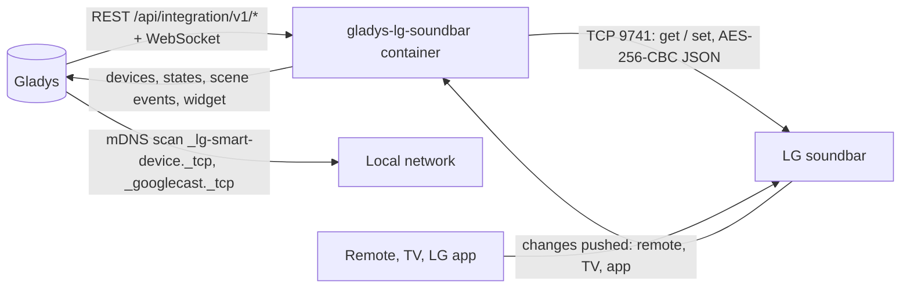
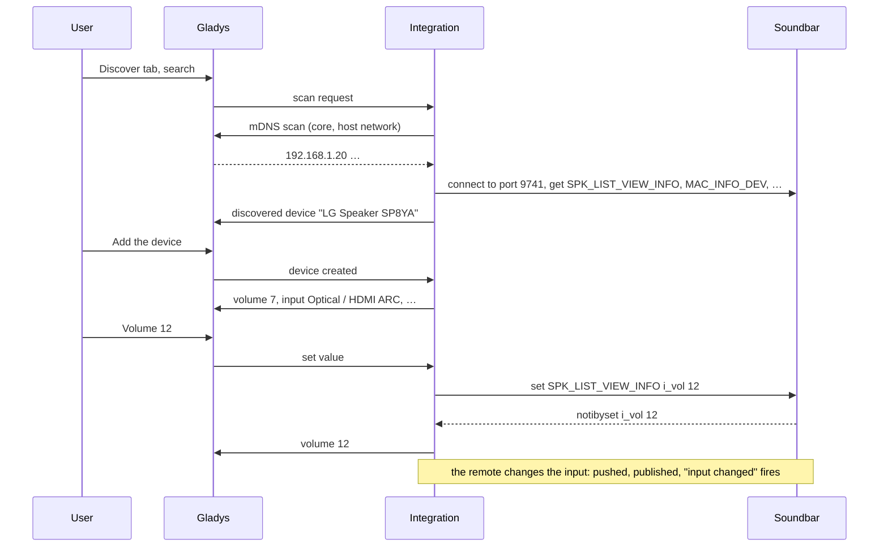
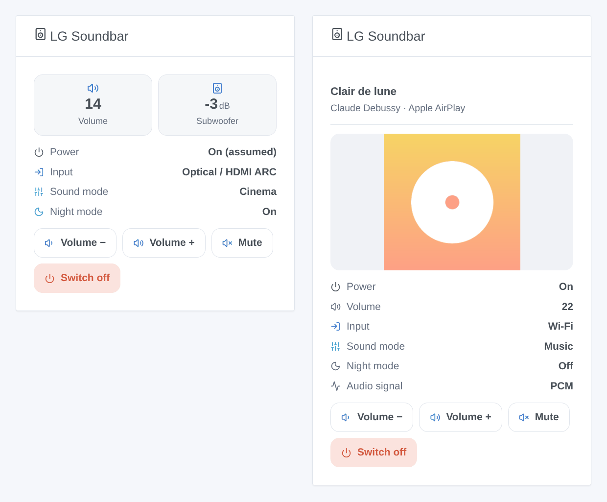

# Gladys LG Soundbar

**English** · [Français](README.fr.md) · [Deutsch](README.de.md) · [Español](README.es.md)

[](LICENSE)
[](https://github.com/William-De71/gladys-lg-soundbar/releases)
[](https://github.com/William-De71/gladys-lg-soundbar/actions/workflows/release.yml)
[](https://gladysassistant.com)


[Gladys Assistant](https://gladysassistant.com) external integration for the **LG Wi-Fi soundbars** controlled by the LG Sound Bar (or Wi-Fi Speaker) app: power, volume, mute, input, sound mode, night mode, speaker levels and what is playing, on your local network only. Changes made with the remote or the TV show up in Gladys at once, and your scenes can react to them or apply a sound preset.

User documentation: [English](docs/en.md) · [Français](docs/fr.md) · [Deutsch](docs/de.md) · [Español](docs/es.md).

Not affiliated with LG Electronics. **Not tested with a real soundbar yet**: the protocol was rewritten from [python-temescal](https://github.com/google/python-temescal) (the library of the Home Assistant integration), and the test soundbar it is checked against was itself checked with that library.

## Features

- **Soundbars found by themselves** (mDNS through Gladys: the LG and Chromecast announcements), or by their IP address.
- **One device per soundbar**, with what the model reports: power, volume (bounded to the maximum of the soundbar), mute, input and sound mode (lists read from the soundbar), night mode, auto volume, dynamic range control, auto power on, subwoofer / rear / center / up-firing levels in dB, play / pause, track and artist while streaming, audio signal.
- **Pushed, not polled**: one connection kept per soundbar; a change made with the remote, the TV (HDMI CEC) or the LG app is in Gladys within a second. Nothing is asked to a soundbar in standby, which a request would switch on.
- **5 scene triggers** (input changed, sound mode changed, new track, soundbar unreachable, reachable again), **2 scene actions** (apply a sound preset, change the volume by steps) and **1 dashboard widget** (state, cover of the track, a small remote).
- Local only: no account, no cloud, nothing leaves your network.
- Four languages everywhere: English, French, German, Spanish.

## How it works




From the search to a command:



### Transport

`transports: ["local"]`: the integration talks to the soundbars on your local network only, over their TCP port 9741 (the "temescal" protocol of the LG app: JSON encrypted with AES-256-CBC and the fixed key every client uses). The search goes through Gladys (mDNS). The only other request is the cover of a track, fetched from the soundbar itself (its port 7000) when it gives one. **Nothing leaves your network.** `/data` keeps the soundbars seen (address, model, last state), so a restart does not need to ask them anything.

## Devices and features

| Feature                                     | Gladys type             | Notes                                                                                                                                                                         |
| ------------------------------------------- | ----------------------- | ----------------------------------------------------------------------------------------------------------------------------------------------------------------------------- |
| Power                                       | television / binary     | `b_powerkey`; reported by recent models (`b_powerstatus`), **assumed** otherwise (last order, on when used, off when unreachable). Some models ignore "off" over the network. |
| Volume                                      | television / volume     | 0 to the maximum the soundbar reports (often 40)                                                                                                                              |
| Mute                                        | switch / binary         | 1 = muted                                                                                                                                                                     |
| Input                                       | text / select           | inputs listed by the soundbar (Wi-Fi, Bluetooth, Optical / HDMI ARC, HDMI…); an unlisted current input shows as its listed equivalent (E-ARC → Optical / HDMI ARC)            |
| Sound mode                                  | text / select           | sound modes listed by the soundbar (AI Sound Pro, Standard, Cinema, Music…)                                                                                                   |
| Night mode, auto volume, DRC, auto power on | switch / binary         | when the model reports them                                                                                                                                                   |
| Subwoofer, rear, center, up-firing levels   | television / volume, dB | the range of the soundbar (−15 to +6 dB for the subwoofer of an SP8YA)                                                                                                        |
| Playback                                    | music / playback_state  | 1 playing, 0 paused; only for music streamed to the soundbar                                                                                                                  |
| Track, artist                               | text                    | while streaming (Chromecast, AirPlay, Spotify Connect…)                                                                                                                       |
| Audio signal                                | text                    | recent models: "DOLBY AUDIO", "PCM", "NO SIGNAL"                                                                                                                              |

## Scene triggers, actions and widgets



The images are **generated illustrations**, drawn from the real widget code on made-up data, not screenshots.

**Widget "LG Soundbar"** (one soundbar, the first one by default): volume and subwoofer tiles, power, input, sound mode, night mode and audio signal, the track and its cover while streaming, and four buttons: volume −, volume +, mute / unmute, switch on / off.

**Scene triggers** — only for changes made outside Gladys (remote, TV, LG app), never for a change Gladys has just sent:

| Trigger                         | Filters                   | Variables                       |
| ------------------------------- | ------------------------- | ------------------------------- |
| LG Soundbar: input changed      | soundbar, new inputs      | input, previous input           |
| LG Soundbar: sound mode changed | soundbar, new sound modes | sound mode, previous sound mode |
| LG Soundbar: new track          | soundbar                  | title, artist, streamed by      |
| LG Soundbar: unreachable        | soundbar                  | —                               |
| LG Soundbar: reachable again    | soundbar                  | —                               |

Power, volume, mute and the switches are numeric features: use the usual "device state changed" trigger of Gladys for them.

**Scene actions**:

| Action                            | Fields                                                              | Outputs                   |
| --------------------------------- | ------------------------------------------------------------------- | ------------------------- |
| LG Soundbar: apply a sound preset | soundbar, input, sound mode, night mode, volume (empty = unchanged) | volume, input, sound mode |
| LG Soundbar: change the volume    | soundbar, steps (−20 to +20)                                        | volume                    |

Examples:

- **Input changed** to Bluetooth → switch the TV off and dim the living room: someone plays music from a phone.
- **At 10 pm** → apply the preset "Optical / HDMI ARC, Cinema, night mode on, volume 12".
- **When the phone rings** → change the volume by −8; when the call ends, +8.

## Requirements

- Gladys Assistant **5.1.0** or later (dashboard widgets and scene triggers / actions): older instances cannot install the integration.
- An LG Wi-Fi soundbar set up with the **LG Sound Bar** or **Wi-Fi Speaker** app, on the same network as Gladys (or reachable on TCP 9741 from it). Some recent models, controlled only by **LG ThinQ**, do not open port 9741 (python-temescal issue #14): they cannot work.
- A fixed IP address for the soundbar (DHCP reservation) is best; the integration follows a soundbar that changes address by searching again.

### Standby and the single connection

A soundbar in standby switches on when it is asked something (python-temescal issue #7): the integration reads the state when it starts and after the soundbar was unreachable, then only listens. The option **Never wake the soundbar** removes those readings. Whether a soundbar accepts several clients at once (the LG app, Home Assistant and Gladys) is not documented: if commands stop working while another tool is connected, close it.

## Installation

- **From the store**: Integrations → LG Soundbar → Install.
- **From the repository URL**: Integrations → Install from a URL → `https://github.com/William-De71/gladys-lg-soundbar`.
- **Developer mode**: run the container yourself with the variables Gladys shows (see Development).

## Configuration

| Field                   | Default | Meaning                                                                                               |
| ----------------------- | ------- | ----------------------------------------------------------------------------------------------------- |
| IP addresses            | empty   | soundbars the search does not find (another subnet, multicast blocked), comma separated               |
| Search the network      | on      | mDNS search through Gladys at each search of the Discover tab, and when a soundbar stops answering    |
| Never wake the soundbar | off     | never ask a soundbar anything by itself: the state comes from its changes and from your commands only |
| Language of the names   | English | feature names, inputs, sound modes and scene texts (Gladys does not tell the language of the user)    |

**Search and test the soundbars** (configuration button) searches, then lists every soundbar found with its address, its model and whether it is connected.

## Usage

1. Set the soundbar up in the LG Sound Bar app, on the network of Gladys.
2. Install the integration; press **Search and test the soundbars**.
3. **Discover**, then add your soundbar as a device.
4. Add the widget to a dashboard; build scenes with the features, the triggers and the actions.

## Development

```bash
npm install
npm test                       # node --test, fake soundbars on 127.0.0.1, never the network
npm run lint                   # ESLint
npm run format:check           # Prettier
npx github:GladysAssistant/integration-store . --skip-image-check
node scripts/fake-soundbar.mjs 9741 SP8YA   # a fake soundbar to try the integration without one
scripts/check-simulator.sh     # the fake soundbar against python-temescal 0.5 (virtualenv)
scripts/build-cover.sh         # cover.jpg from docs/assets/cover.svg
docs/illustrations/render.sh   # docs/assets/widgets.<lang>.png
```

Locally, the SDK reads `GLADYS_HOST_API_URL`, `GLADYS_INTEGRATION_TOKEN` and `GLADYS_INTEGRATION_SELECTOR` (given by Gladys in developer mode); `LG_SOUNDBAR_DATA_DIR` moves `/data`. `DEBUG=gladys-integration-sdk` shows the SDK logs.

The tests cover the cipher (a frame produced by python-temescal), the framing (split, merged, plain JSON, garbage), the client (one request at a time, refusals, timeouts, silent reconnection, growing retry delay, a new address), the state built from the messages of real models (SP8YA, S90QY), the commands and their bounds, the devices (the fields the Discover tab requires, the category / type pairs), the scene events, the widget (`validateWidgetContent`), the manifest, the four languages, the release script, and the whole integration against the fake Gladys of the SDK and fake soundbars on real sockets. `test/structure.test.js` freezes every key users store.

## Release process


Every merge on `main` runs the CI, then computes the version from the [Conventional Commits](https://www.conventionalcommits.org/) since the last tag: `feat` → minor, `fix` / `perf` → patch, `!` or `BREAKING CHANGE` → major (a minor below 1.0.0); `docs`, `chore`, `ci`, `test`, `style`, `refactor`, `build` alone publish nothing. The changelog section is generated, the tag pushed, the multi-architecture image built, then `main` receives the release commit, the GitHub Release is created and a last job checks the public image, the store validator and the topic.

- The pull request title becomes the squash commit, then the changelog line: write it in English, for the user (`pr-title.yml` checks it). Never edit `CHANGELOG.md` by hand.
- 1.0.0 is a decision: Actions → Release → Run workflow with `release-as: 1.0.0`. `dry-run` shows the version and the notes without publishing.
- **Protected branch**: the release pushes its commit to `main` with `GITHUB_TOKEN`. The `protect-main` ruleset (no deletion, no force-push) lets it through; a stricter rule (pull request required, status checks) would need GitHub Actions in its bypass list, or a GitHub App.
- After the first release, make the `ghcr.io` package public (Package settings → Change visibility), or Gladys cannot pull it.

## Troubleshooting

See [docs/en.md](docs/en.md#troubleshooting). Report issues with the versions of Gladys and of the integration, the model and firmware of the soundbar, the message of **Search and test the soundbars** and the logs with `DEBUG=gladys-integration-sdk`.

## Contributing

Issues and pull requests are welcome. Run `npm run format:check && npm run lint && npm test` before opening a pull request, and keep every external id and stored key unchanged (see [CLAUDE.md](CLAUDE.md)). A capture of what your model answers (`scripts/fake-soundbar.mjs` shows the format) helps more than anything.

## Security

See [SECURITY.md](SECURITY.md): report vulnerabilities privately. The integration has no secret to keep; it only opens connections to the addresses found on your network or typed in the configuration, and fetches a cover from the address of the soundbar only.

## Screenshots to come

The images above are illustrations, not screenshots. Real screenshots will go in `docs/assets/screenshots/` (PNG, 1280 × 800): `configuration.png`, `discovery.png`, `device.png` (a soundbar with its features on a dashboard), `scene-trigger.png` (the "input changed" trigger), `scene-preset.png` (the "apply a sound preset" action).

## License

[Apache License 2.0](LICENSE) — see also [NOTICE](NOTICE). LG is a trademark of LG Electronics. Thanks to the Gladys documentation and SDK, to python-temescal (Google LLC, Apache 2.0) for the protocol, and to the Home Assistant integration and lgsb2mqtt for what real soundbars report.
